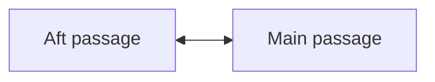

# Submarine — Deck Explorer

A Street View style submarine prototype made from Blender panoramas. Drag to look
around and click destinations on the bottom compass to move between the nine camera
positions. Routes rotate around the compass relative to the direction you are looking. Moving preserves
your heading and tilt. All connected passages are open; there are no inventory,
puzzles, locks, or save-game requirements.

Travel uses a short eased camera push in the selected direction, blended into the
next panorama. Connected images preload in the background. Movement waits for the
animation to finish, while looking around remains available. Reduced-motion
preferences skip the travel animation. This simulates movement between photographs;
it does not require a 3D model or depth maps in the browser.

## Play locally

Requires Node.js 22+ and Python 3; no npm dependencies to install.

```sh
npm run dev
# Open http://127.0.0.1:5173/
```

Drag with a mouse or one finger to look. Use +/− to zoom. Click a destination on
the compass to move. The top of the compass is ahead, the bottom behind; destination
labels stay upright as routes and compass bearings rotate with your view.
W/A/S/D move toward a connected position in front/left/behind/right;
arrow keys look around; number keys select compass routes and stay stable while panning.
Click the compass center to face north. M toggles the deck map. The interface fits the
browser window, including phones.

## Render and connect locations yourself

1. Edit `render-config.json` to select your Blender file and render quality.
2. Edit `scripts/panorama-cameras.json` to map Blender camera **object names** to
   permanent location IDs. The existing nine cameras are already configured.
3. Run `npm run render`, or double-click `scripts/render-panoramas.command` on
   macOS. It renders every mapped camera, replaces the JPGs and manifest in
   `panoramas/`, then validates the map and rebuilds `dist/`.
4. Edit **`map.mmd`** to name locations and connect them. The navigator reads this
   Mermaid file directly. Reload the browser to see your changes.

For example, this connection in `map.mmd` creates movement in both directions:



The location IDs must match the camera mapping. Labels can change freely without
renaming images. Use `<-->` or `---` for a two-way passage and `-->` for one-way
travel. Add a `%% start: stand_00` comment to select the starting position and
`%% yaw: 0` for its heading. Keep one statement per line. Subgraphs are optional.

For a new camera, add its name/ID to the camera mapping, declare that ID and its
connections in `map.mmd`, then rerender. Every rendered location must be in the
map and reachable from the start. The build explains missing IDs, broken
connections and missing images rather than silently generating invalid arrows.

Read [the complete rendering guide](docs/panorama-rendering.md) for standalone
commands, camera naming, quality settings, visual-state renders and troubleshooting.
[Map authoring details](map.md) explain supported Mermaid syntax and orientation.

## Quality of the included images

All nine locations include 4096×2048 panoramas rendered on the Apple M1 Max GPU
using Metal, at 256 Cycles samples. `npm run render` defaults to 64 samples
for quicker iteration. Increase `width` and `samples` in `render-config.json`
when ready. Image dimensions are recorded in the manifest. The Blender source
has not been modified.

## Check and build

```sh
npm test
python3 -B -m unittest discover -s tests -p '*_test.py'
npm run build
```

`dist/` contains the viewer, live Mermaid map, render manifest and referenced JPGs.
The viewer uses a small WebGL renderer with no CDN or runtime dependencies. The viewer corrects small left/right render-edge mismatches while loading each
panorama, and uses subtle dithering to reduce display banding. Only three panorama
textures are retained in GPU memory. Original prototype art folders
remain in the checkout for reference and are excluded from the new build.

GitHub Pages continues to use `.github/workflows/pages.yml` on pushes to `main`.
All asset paths remain relative for the `/submarine-game/` project path. Pushing `main` runs validation and publishes the current prototype.
