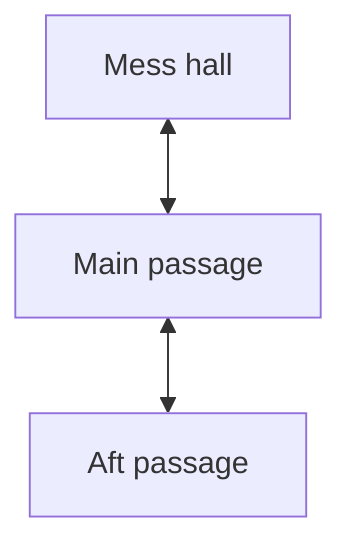

# Render every camera and connect the results

This workflow runs locally without an assistant or additional npm libraries.
Requirements: Blender, Python 3, and Node.js 22+.

## Quick start

Open Terminal in the repository folder:

```sh
npm run render
npm run dev
```

On macOS you can also double-click `scripts/render-panoramas.command` in Finder.
It works from any current directory and handles spaces in file paths. The launcher
uses `render-config.json`, runs Blender in the background, renders the selected
cameras, and runs the game build to validate your connections and image files.
The original Blender file is never saved or overwritten.

The supplied settings point to `~/Desktop/Submarine Layout Example.blend`. Change
`blend_file` when moving the source. The nine existing camera objects are already
mapped in `scripts/panorama-cameras.json`.

## Settings

```json
{
  "blend_file": "~/Desktop/Submarine Layout Example.blend",
  "camera_map": "scripts/panorama-cameras.json",
  "width": 4096,
  "samples": 64,
  "device": "GPU"
}
```

Relative paths resolve from the repository; `~` resolves to your home folder.
Output always goes to the repository's `panoramas/` folder, which the game reads.
Width must be positive and even; height is half. GPU rendering is configured for
this Mac's Apple M1 Max Metal device. On another machine, configure Cycles GPU
devices in Blender preferences, or set `device` to `CPU` to render without GPU
setup.

The launcher looks for Blender on PATH, then `/Applications/Blender.app`. For
another install, add a `blender` entry containing its executable's absolute path,
or pass `--blender` on the command line. On Windows this is the path to
`blender.exe` inside the Blender installation.

Override quality or the source for one pass:

```sh
npm run render -- --blend "/path/to/Submarine.blend" --width 4096 --samples 64
```

Inspect the exact command without rendering or changing anything:

```sh
npm run render -- --print-command
```

Use `--no-build` to render without the final map/build check. A failed render or
map validation returns a nonzero exit code and a readable message. If rendering
succeeds but map validation fails, fix `map.mmd` and run `npm run build`; you do not
need to rerender the images.

## Camera names become game IDs

Camera mappings use **object names** from Blender's Outliner, not camera data names:

```json
{
  "Camera": "hall_00",
  "Camera.001": "hall_01",
  "Camera.002": "mess_entry"
}
```

This example would write `hall_00.jpg`, `hall_01.jpg`, and `mess_entry.jpg`.
The shipped mapping uses `stand_00` through `stand_08` to match the live map.
Keep IDs permanent. Use lowercase letters, digits and single underscores,
beginning with a letter. Duplicate IDs or references to missing cameras fail
before rendering. Only mapped cameras are selected, so helper cameras can be left
out. Add every new standing camera to the mapping before the next export.

Alternatively, set `camera_map` to `null` and name the Blender camera objects
`hall_00`, `hall_01`, etc. Every camera in the active scene will then be rendered
using its object name. No mapping file is required in that mode.

## The Mermaid file is the connection map

Edit `map.mmd` directly. The game reads it on reload; it is not merely a diagram.
The IDs must be the same ones used in the camera mapping:



`<-->` and `---` are two-way passages; `-->` is one-way. Labels can change without
renaming assets. Keep one statement per line. See [map authoring](../map.md) for
inline nodes, chains, subgraphs, starting position, and validation rules.

For a new location: add the camera mapping and Mermaid node/connections, then
rerender. For connection or display-name changes only, save the Mermaid file and
reload the game. Run `npm run build` to update a distributable `dist/` copy.

## Output and how the navigator finds it

```text
panoramas/
  stand_00.jpg
  stand_01.jpg
  ...
  manifest.json
```

The exporter writes exact filenames without frame numbers, sets Cycles to full
360° × 180° equirectangular projection, and uses a level camera with Euler rotation
`(90°, 0°, 0°)`: optical forward +Y, right +X, up +Z. It uses evaluated world camera
positions at the saved frame, including parent/constraint position effects.
Source camera rotations do not rotate the output.

The manifest contains image filenames, real XYZ camera positions, projection,
orientation, dimensions, samples, frame and view layer. The game matches manifest
IDs to Mermaid IDs, derives movement bearings from coordinates, and loads each
image relative to the manifest URL. There is no manual asset import step.

Rerunning the launcher replaces existing output files. The manifest is published
only when the full pass finishes. The build copies only referenced images and the
map; stale JPGs and the original prototype assets are excluded.

## Quality and render appearance

Use 1024 or 2048 width and a low sample count for quick navigation checks. Try
4096 or 8192 width and a higher sample count for final art. A 90° view spans about
one quarter of the panorama's width, so 2048 yields about 512 horizontal pixels
within that view. Higher resolutions take more time and texture memory.

All nine included panoramas are 4096×2048, rendered with 256 Cycles samples on the
Apple M1 Max Metal GPU. The launcher defaults to 64 samples for quicker iteration. The viewer also
supports mixed image sizes as long as each image is 2:1; normal full exports have
uniform dimensions.

Lighting, materials and color management come from the blend. Exports disable
camera depth of field, motion blur, borders, stereo, stamps, compositing and the
video sequencer. Adapt the exporter if your final look relies on a compositor.

## Advanced direct Blender command

The renderer itself is `scripts/render_panoramas.py`. To run it directly from the
repository folder on this Mac:

```sh
"/Applications/Blender.app/Contents/MacOS/blender"   --background --disable-autoexec   "$HOME/Desktop/Submarine Layout Example.blend"   --python-exit-code 1 --python scripts/render_panoramas.py --   --camera-map scripts/panorama-cameras.json   --output ./panoramas --width 4096 --samples 64 --device GPU --overwrite
```

Arguments after `--` belong to the renderer. `--list` lists cameras/positions without
rendering. `--dry-run` validates and prints planned filenames without writing files.
`--scene`, `--frame`, and `--view-layer` select another saved scene state.

For a visual variant, prepare a view layer with the relevant collection excluded
from rendering, then add `--state no_book --view-layer NoBook`. This writes
`<id>__no_book.jpg` and `manifest__no_book.json`; the flag only names the appearance
and does not hide objects. The current free-exploration game loads only the default
manifest. Variant/gameplay selection would be a separate feature.

## Checks

```sh
npm test
python3 -B -m unittest discover -s tests -p '*_test.py'
npm run build
```

Blender references: [panoramic cameras](https://docs.blender.org/manual/en/latest/render/cycles/object_settings/cameras.html),
[command-line arguments](https://docs.blender.org/manual/en/latest/advanced/command_line/arguments.html),
and [render operator](https://docs.blender.org/api/current/bpy.ops.render.html).

The navigator reconciles small wrap-edge color mismatches when uploading images
to the GPU. It preserves the central image and strong geometric edges. Screen-wide
vignette gradients are omitted, and subtle shader dithering reduces visible display
banding on the gray surfaces. Physical lights remain part of the Blender renders.
