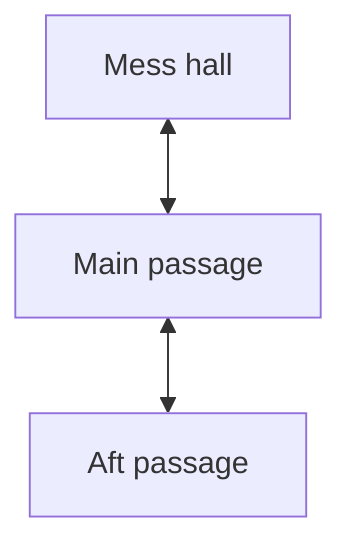

# Editing the navigator map

**`map.mmd` is the live map.** The browser and build use the same parser to read it.
There is no second JSON graph to update. Open the file in any Mermaid editor to
visualize it, or edit it as plain text. Reload the game after saving.

## Names and connections

A location ID is the value assigned to a camera in `scripts/panorama-cameras.json`.
The exporter writes `panoramas/<location_id>.jpg` and includes the camera's real
world position in `panoramas/manifest.json`. Do not derive IDs from camera list
order. The default nine IDs stay stable even if Blender camera order changes.

This is an authoring example; the supplied file uses the existing `stand_00` through
`stand_08` IDs. You can rename the labels in square brackets without touching the
camera mapping or rendered filenames. To rename an ID, update both the camera
mapping and Mermaid file, then rerender.

Supported syntax:

- `flowchart BT`, `flowchart TD`, `flowchart LR`, `flowchart RL`, or the equivalent
  `graph` header. Diagram layout does not determine compass bearings.
- `id["Display name"]`, `id[Display name]`, or a bare ID. Quote labels for clarity.
- `a <--> b` or `a --- b` creates a two-way connection. Declare each passage once.
- `a --> b` allows travel only from a to b. It does not add a return arrow.
- Inline declarations and chains work: `a["A"] <--> b["B"] <--> c["C"]`.
- Optional `subgraph ...` / `end` groups and `direction` statements organize the
  diagram. `style`, `classDef`, `class`, and `linkStyle` affect only diagram styling.
- `%%` comments, including `%% start: id` and `%% yaw: 0`. If no start is supplied,
  the first location is used. The initial heading defaults to north.
- One statement per line; a trailing semicolon is allowed.

Use lowercase IDs beginning with a letter, with digits and single underscores.
The navigator intentionally supports this small subset of Mermaid rather than
arbitrary flowchart features. Edge labels, other node shapes and multiple
semicolon-separated statements on one line are not supported. Invalid syntax
reports the map filename and line number.

## Adding or removing a standing location

To add one, create a camera in Blender, add its object name and permanent ID to
`scripts/panorama-cameras.json`, add the same ID and a passage in `map.mmd`, then
run `npm run render`. To remove one, remove it from both files and rerender.
Every rendered ID must appear in the map; every map ID needs a render. All locations
must be reachable from the start. Extra old JPGs are ignored by the game and build.

If you prefer naming camera objects directly after location IDs, set `camera_map`
to `null` in `render-config.json`. Then every camera in the scene is exported using
its object name. Blender-generated names such as `Camera.001` are deliberately
rejected in that mode; map them or rename them first.

## Orientation

The image manifest supplies actual camera XYZ coordinates; do not duplicate or
maintain guessed coordinates in the diagram. The exporter sets every panorama to
a level north-facing camera: +X east, +Y north, +Z up. Yaw is clockwise from north:
0 north, 90 east, 180 south, 270 west. Positive pitch looks up.

Arrows use destination minus source coordinates to calculate travel bearing, then
subtract the player's yaw to indicate ahead, behind, left or right. Looking around
changes the view and arrow bearings without changing location. Moving preserves
yaw, pitch and zoom. Diagram layout and the direction of a Mermaid edge on screen
do not affect those bearings.

The supplied graph follows the inspected Blender wall layout: the side
compartments are reached from the forward junction, rather than by crossing the
main passage walls. Visible doors do not block movement in this prototype.

## Validation

Run `npm run build` after map edits to check syntax, matching IDs, duplicate
passages, unreachable locations, zero-length connections and image presence.
During local development, the browser runs the same graph checks and shows a
readable error if the map is invalid. For a public build, rerun `npm run build` so
`dist/map.mmd` includes your edits.
